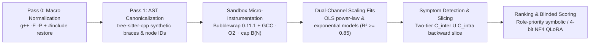

# Execution-Annotated Program Graphs (EAPG)

Research artifact and companion manuscript (**[paper.pdf](manuscript/paper.pdf)**) for localizing growth-changing edits in C++17 programs. EAPG pairs execution hit counts with static container-operation work proxies, fits finite-range scaling models inside an isolated compiler/execution sandbox, extracts two-tier scope-isolated backward slices around growth symptoms, and ranks candidate edit sites symbolically or via 4-bit QLoRA adapters (`Qwen2.5-Coder-1.5B`).

---

## Pipeline Overview



For architectural specifications, prompt schemas (`raw_code`, `hotspot_raw`, `static_eapg`, `abstract_hits_only`, `abstract_graph`, `full_eapg`), and ledger commitments, see [docs/ARCHITECTURE.md](docs/ARCHITECTURE.md).

---

## Key Verified Results

All numbers below replay directly from committed JSON receipts via `python -B eapg.py verify`:

1. **Frozen 100-Pair Pilot — Symptom Coverage & Slice Reduction** ([`tab:eapg-pilot-slicing`](manuscript/evaluation.tex), [`artifacts/scope_isolated_pilot/pilot100_results.json`](artifacts/scope_isolated_pilot/pilot100_results.json)):
   - Work weighting increases symptom coverage from `80/100` (hits-only) to **`100/100`** (`+9` container copies in `A1.2`, `+11` linear scans in `A1.3`).
   - Two-tier pruned slicing retains **`100/100`** mechanism references with mean size **`1.90`** (`89.0%` search reduction) vs. `4.89` unpruned (`71.2%` reduction).
2. **Strict 13-Group Six-Representation Ablation (`Qwen2.5-Coder-1.5B` 4-bit NF4)** ([`replay_resplit_ablation.py`](development/replay_resplit_ablation.py), [`artifacts/pilot_resplit/ablation_results.json`](artifacts/pilot_resplit/ablation_results.json)):

   | Method / Representation | Constrained All (100) | Multi-candidate (66) | Off-symptom (18) |
   |---|---:|---:|---:|
   | `raw_code` (QLoRA) | 66/100 (67.84%) | 32/66 (58.19%) | 11/18 (67.50%) |
   | `hotspot_raw` (QLoRA) | 83/100 (79.85%) | 49/66 (73.81%) | 15/18 (75.00%) |
   | `static_eapg` (QLoRA) | 74/100 (66.43%) | 40/66 (56.36%) | 9/18 (50.00%) |
   | `abstract_hits_only` (QLoRA) | 78/100 (72.32%) | 44/66 (64.02%) | 9/18 (58.33%) |
   | **`abstract_graph` (QLoRA)** | **90/100 (84.44%)** | **56/66 (79.77%)** | 11/18 (70.83%) |
   | `full_eapg` (QLoRA) | 75/100 (58.27%) | 41/66 (45.75%) | 3/18 (23.33%) |
   | Unbiased symbolic (`def_use=False`) | 70/100 (76.92%) | 36/66 (70.00%) | 14/18 (83.33%) |
   | Pilot-refined symbolic (`def_use=True`) | 96/100 (92.31%) | 62/66 (90.00%) | 14/18 (83.33%) |

3. **Bounded Prospective 10-Family Scalar Cohort (Part A — Dual-OS Verified, `primary_sized=false`)** ([`development/prospective_multiagent_results.json`](development/prospective_multiagent_results.json)):
   - Verified identically across unmodified Linux WSL2 Bubblewrap (`0.11.1`, GCC `15.2.0`, FD `199`, all four Gate 1 probes passing) and Windows 11 native (`MSYS2 GCC 15.1.0`, RTX 4060 8 GB): `80` drawn families (`322` slots, below the `60`-family confirmatory gate), `280` placeholder-quarantined slots (bridged cleanly with `0` real collisions across `101` pilot+PIE exposure rows and `0` prompt-token collisions), `42` active slots across `10` unseen scalar families (`0` overlap with `77` pilot templates), `378` oracle builds, `6,804` oracle runs, `738` profiles, byte-identical `score.json` (`ce049b32...`).
   - Core (`20` positives): **`work_scoped` (`def_use=False`, `15/20 = 75.00%`)** (`16/20` retention, `89.38%` reduction; matching `hits_scoped` at `15/20`) beats pilot-refined `work_scoped_symbolic` (`def_use=True`, `14/20 = 70.00%`) and **`work_conventional` (`0/20 = 0.00%`)** (`20/20` retention, `64.34%` reduction; **`+75.00 pp`**, `[+60.00, +90.00]`, caused by shared ranker hoisting CFG-reachable `STATE_UPD` initializers/accumulators ahead of the symptom). False alerts: `5/10` quadratic shams, `10/10` appropriate controls.
   - Live 4-bit NF4 GPU inference (`20` core positives, max `2.182 GiB` VRAM): `hotspot_raw` fold-0 reaches **`13/20 (65.00%)`**, outperforming `abstract_graph` fold-0 (`11/20`, `55.00%`) and unadapted base (`12/20`, `60.00%`) (`14/21` / `11/21` / `12/21` when including duplicate `F01` `comparator_swap_positive`).

4. **Bounded Blinded Three-Agent Contract & Strict OOF Contrast (Part B — `positive_transfer_evidence=false`)** ([`development/test_prospective_multiagent_study.py`](development/test_prospective_multiagent_study.py)):
   - Three role-separated isolated subagents resolved `14/14` positive pairs across `11` groups (`12` out-of-fold pilot pairs, `1` authored smoke pair, `1` sub-`0.50` timing pair `PIE_DEV_p03497`, below the `20`-group confirmatory threshold) alongside `2` negative controls, while Windows GCC `15.1.0` (`2c95df0e`) replicated archived Linux `c4260272` stress outputs across all `72` runs.
   - Strict out-of-fold `abstract_graph` scores **`10/14 (63.64% group / 71.43% pair)`** (vs. partially in-fold `fold-0` at `12/14 = 81.82%`), outperforming **unbiased `symbolic` (`def_use=False`, `6/14`, `54.55% group`)** by `+9.09 pp` (`[-27.27, +45.45]`, `6` vs. `2` pairs) and matching **pilot-refined `symbolic` (`def_use=True`, `10/14`, `63.64% group`)** (`0.00 pp`, `[-36.36, +36.36]`, `2` vs. `2` pairs), with `8/10 (71.43%)` vs. `4/10 (57.14%)` on `D_rank` and `1/2` negative control alerts.

5. **Calibration, Domain & Boundary Bounds:**
   - Library calibration agrees with operation counts in `6/8` conditions across `-O0/-O2/-O3` (`480` checks).
   - Raw-AST scalar comparator eligibility is `0/100` on pilot and `0/714` on UOJ-Bench (`11` header-clean across `10` problems); `5/11` OEIS specs qualify across `4` mechanisms (`work_scoped` `3/5` vs. `work_conventional` `0/5`); transitive (`d > 0`) and two-scope (`F10`, `A400004`) fixtures establish tight scoped-slice boundaries.

---

## Quickstart

Requires **Python >= 3.11** (verified on Python 3.14; set `PYTHONUTF8=1` when calling frozen `pipeline.py` directly on Windows CP1252, handled automatically inside `eapg.py`):

```sh
# 1. Inspect repository hashes, JSON digests, and available tools
python -B -S eapg.py status

# 2. Fast core replay (release hashes, contrasts, 13-group ablation, weighted panel, all manuscript tables, multi-agent study; requires git)
python -B -S eapg.py verify --mode fast

# 3. Full platform verification suite (18 common + archived build; on Linux adds 10 AST/selector/slice/intake checks)
python -B eapg.py verify --mode auto --verbose

# 4. On Windows with Ubuntu WSL2: run Windows common suite (18 checks + build) + Linux AST/sandbox suite (10 checks + Gate 1 probes)
python -B eapg.py verify --mode wsl2 --with-probes

# 5. Full pytest suite (19 development test modules + Phase 2 AST/selector tests)
python -B -m pytest -q
```

See [docs/REPRODUCIBILITY.md](docs/REPRODUCIBILITY.md) for optional AST (`pip install -e .[ast,dev]`), 8 GB RTX 4060 GPU (`pip install -e .[gpu]`), PIE acquisition (`artifacts/phase2_data/README.md`), private custody notes, and LaTeX build commands (`python -B eapg.py build-paper --clean`).

---

## Repository Structure

| Path | Purpose | Status / Pinning |
|---|---|---|
| [`eapg.py`](eapg.py), [`pyproject.toml`](pyproject.toml) | Unified pipeline CLI (`verify`, `replay`, `build-candidate`, `study`, `build-paper`, `status`) | Stdlib-only core |
| [`pipeline.py`](pipeline.py) | Frozen Phase 1/2 EAPG profiler, slicer, and ranker | Pinned in [`SHA256SUMS`](SHA256SUMS) |
| [`verify_release.py`](verify_release.py), [`SHA256SUMS`](SHA256SUMS) | Offline cryptographic verifier & file digest manifest | Verified by `verify_release.py` |
| [`manuscript/`](manuscript/README.md) | IEEEtran LaTeX sources, verified tables, bibliography, and compiled [`paper.pdf`](manuscript/paper.pdf) | Reproducible via `pdflatex` + `bibtex` |
| [`development/`](development/README.md) | Candidate patches, Phase 2 sandbox, study harness, audits, tests, and sealed JSON receipts | Indexed in [`development/README.md`](development/README.md) |
| [`artifacts/`](artifacts/README.md) | Frozen pilot outputs, Phase 1 correction, 13-group ablation logits, PIE export, weighted panel | Indexed in [`artifacts/README.md`](artifacts/README.md); core pinned in [`SHA256SUMS`](SHA256SUMS) |
| [`docs/`](docs/ARCHITECTURE.md) | [Architecture](docs/ARCHITECTURE.md), [Reproducibility](docs/REPRODUCIBILITY.md), [Independent Audit](docs/INDEPENDENT_AUDIT.md), and [LLM Handoff](docs/HANDOFF.md) | Reference documentation |
| [`PHASE2_DECISION.md`](PHASE2_DECISION.md), [`AUDIT.md`](AUDIT.md) | Historical gate record and frozen Phase 1 independent audit (`Nov 2026` updates linked) | Phase 1 `AUDIT.md` hash-preserved |
| [`.github/workflows/verify-artifact.yml`](.github/workflows/verify-artifact.yml) | Cross-OS GitHub Actions CI (`windows-latest` & `ubuntu-latest`) | Automated CI |

---

## Scope, Custody & Limitations

- **Bounded Sample Size:** Neither Part A (`10 < 60` families: `primary_sized = false`, `away_from_symptom_evidence = false`) nor Part B (`11 < 20` groups: `positive_transfer_evidence = false`) meets its confirmatory sample-size gate; empirical contrasts are reported strictly as bounded feasibility findings alongside `5/10` sham and `10/10` appropriate-control false alerts.
- **Pre-execution verification & blinded adjudication:** Independent verification of the 10-family scalar cohort (Part A) and blinded source adjudication of the 14+2 external contract (Part B) were executed by four role-separated isolated LLM subagents (rather than recruited human participants), with all attestations, reviews, adjudications, and ledgers cryptographically chained into [`development/prospective_multiagent_results.json`](development/prospective_multiagent_results.json).
- **Held-out external PIE data:** Held-out PIE test submissions, adapter LoRA weights, and private `.codex/private/` bundles remain excluded in private custody (see [`.gitignore`](.gitignore) and [docs/REPRODUCIBILITY.md](docs/REPRODUCIBILITY.md#4-private-custody-artifacts--full-prospective-re-execution)); `12/14` positive Part B pairs draw from published stress mechanisms evaluated strictly out-of-fold across folds `0..4`, alongside `p03497` (failed `< 0.50` wall-clock screen) and authored controls.
